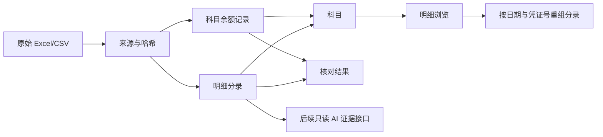

# 项目规划与来源

核查日期：2026-09-23。以下仅用于产品与架构参考，不引入第三方项目代码。

## 项目比较

| 项目 | 可借鉴的能力 | 许可证与取舍 |
|---|---|---|
| [LineLedger](https://github.com/lineledger/lineledger) | 科目至总账穿透、余额表导入与历史分录重放 | AGPLv3；服务端 Laravel，功能范围远超只读尽调。参考交互与核对思路，不复用代码。 |
| [Frappe Books](https://github.com/frappe/books) | 离线桌面、SQLite、总账及余额表 | AGPLv3；Electron 和完整记账功能较重。参考本地账套理念，不复用代码。 |
| [纷析云财务](https://github.com/fenxi365/financial) | 中文凭证、账簿、报表界面 | 仓库 [LICENSE](https://github.com/fenxi365/financial/blob/master/LICENSE) 写明不可商业销售；且依赖 Spring Boot、MySQL、Redis。只作需求参考。 |
| [悟空财务](https://github.com/WuKongOpenSource/Wukong_Accounting) | 中文科目与辅助核算 | [授权协议](https://github.com/WuKongOpenSource/Wukong_Accounting/blob/main/LICENSE.txt) 对商业用途和派生分发设限；部署也较重。不使用其代码。 |

LineLedger 与 Frappe Books 的许可证见各自 [LICENSE](https://github.com/lineledger/lineledger/blob/main/LICENSE)、[LICENSE](https://github.com/frappe/books/blob/master/LICENSE)。本项目基于通用会计概念独立设计。

## MVP 范围

目标是“看账、检索、核对、追溯”，不做记账、审核、结账或报税。用户选择本地文件、校对列映射，软件把来源和分录标准化进单独 SQLite 账套。余额表数值始终保持为企业提供值；明细汇总另列，差异只提示，不自动调平。

### 数据关系

## 下一阶段

1. 用脱敏真实样表建立金蝶、用友及自定义 Excel 导入模板，完善跨期间、科目级次、辅助核算和凭证字段匹配。
2. 增加账套内文件范围管理、列映射模板、导入撤销和大账簿分页。
3. 专题分析先做规则与证据链：借款、实缴出资、关联方、法律风险科目。AI 只对已引用的账簿证据作解释，并标明推断和缺口；是否接入云模型再单独决定。
4. 在 macOS 与 Windows 上分别完成安装包、启动和真实账簿回归测试。
